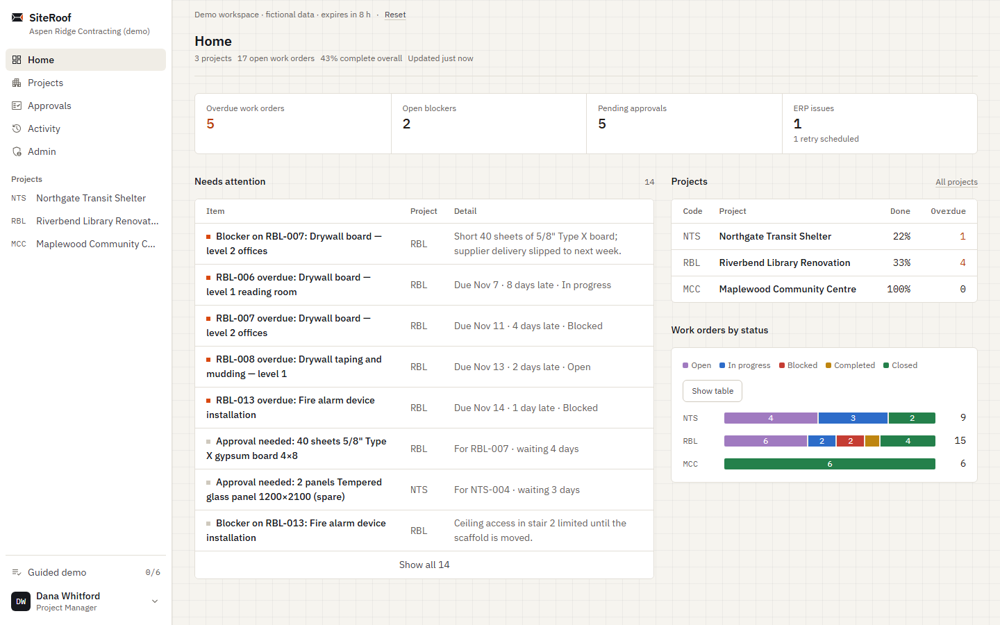
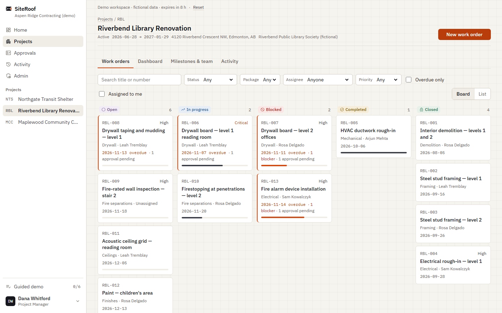
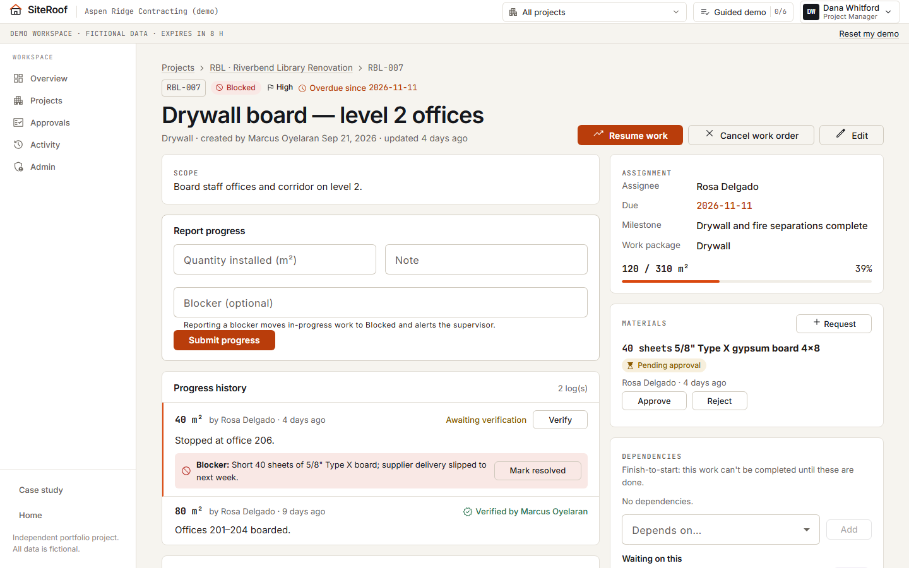
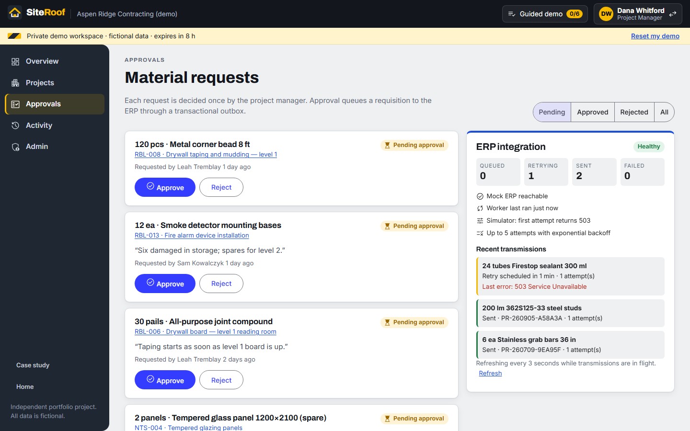
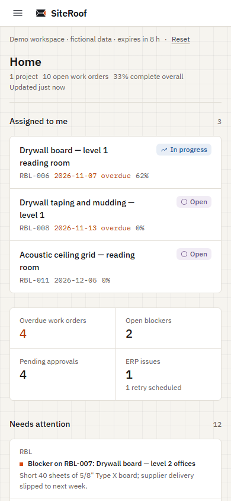
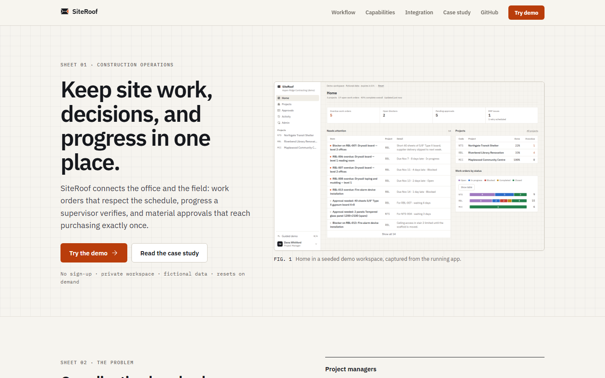

# SiteRoof

**Keep site work, decisions, and progress in one place.**

SiteRoof is a construction operations platform for coordinating projects, milestones, assigned work orders,
site progress and limited material approvals across office and field teams. It has a public landing page, a
case study, and a working demo where each visitor gets a private, seeded workspace.

> **A personal project.** Not affiliated with any construction company. Every project, person, company,
> address and record is fictional.
> **Hosting status: not deployed yet.** See [docs/DEPLOYMENT.md](docs/DEPLOYMENT.md).



| Project board | Work order | Approvals and ERP status |
| --- | --- | --- |
|  |  |  |

| On a phone (crew member) | Landing page |
| --- | --- |
|  |  |

Screenshots were captured from the running app by `tests/e2e/specs/screenshots.spec.ts`. The app is
usable at 375px: the sidebar becomes a drawer (with the profile and guide at its bottom), tables become
stacked rows, the board shows one status column at a time, dialogs open as full-screen sheets and the crew's
progress form has a sticky submit button.

## What it does

- **Projects and milestones**: fictional Edmonton-area projects with rosters, dates and milestone tracking.
- **Work orders**: create, assign (project members only), prioritize, comment, add finish-to-start
  dependencies (cycle-checked), move through Open → In progress ⇄ Blocked → Completed → Closed. Closed work
  is locked; reopening needs a manager and a reason.
- **Field progress**: crews report quantities, notes and blockers; a supervisor other than the reporter verifies.
- **Material approvals**: submitted once, decided once by the project manager, fully audited.
- **ERP integration**: approval writes a transactional outbox event; a background worker delivers it to a
  self-hosted mock ERP that returns 503 on the first attempt, retries with bounded backoff, and stores the ERP
  reference. Idempotency keys prevent duplicates.
- **Dashboards**: overdue work, completion by work package, open blockers, approval backlog and recent
  activity, all queried from SQL Server (two documented T-SQL views) on every load.
- **Activity and audit trail**: actor, timestamp and before/after values of changed fields.
- **Rule-based blocker summary**: deterministic, evidence-linked, clearly labelled. An interface for an
  optional language-model provider is defined but has no implementation and is off.
- **Guest demo**: one click provisions an isolated tenant; switch between manager, supervisor and crew;
  reset any time; workspaces expire automatically.

The guided demo scenario: *Open Riverbend → inspect delayed work → submit progress → approve material
request → see the dashboard and ERP status update.*

## Stack

Angular 22 (standalone, signals, strict TypeScript, SCSS, Angular Material re-skinned to a small token-based design system) · ASP.NET Core on .NET 10 ·
EF Core 10 · SQL Server 2022 · xUnit + Testcontainers · Vitest · Playwright · Docker · GitHub Actions.
One container: the API serves the Angular build from the same origin (cookie auth + CSRF, no CORS).

## Run it locally

Prerequisites: .NET SDK 10, Node 24, Docker. Ports used: SQL Server **1434**, API **5080**, Angular dev **4200**.

```powershell
Copy-Item .env.example .env      # then set a strong MSSQL_SA_PASSWORD and the same password in the connection string
docker compose up -d db          # SQL Server 2022 on 127.0.0.1:1434
dotnet tool restore
./scripts/dev-api.ps1            # API on http://localhost:5080, applies migrations on startup
./scripts/dev-web.ps1            # in another terminal: Angular on http://localhost:4200 (proxies /api)
```

Open http://localhost:4200 and click **Try the demo**.

Production-like single container on http://localhost:8080:

```powershell
docker compose --profile full up -d --build
```

## Tests

```powershell
dotnet test                                   # xUnit unit + integration (starts SQL Server via Testcontainers)
cd web; npm ci; npm run lint; npm test; npm run build
cd ../tests/e2e; npm ci; npx playwright install chromium; npx playwright test --project=chromium
```

The must-pass business tests (crew URL tampering, approvals logged/idempotent/forbidden for crew, ERP 503 then
retry without duplicates, 409 on conflicting edits, dashboard/database/activity updates) run at both the API
level and in the browser. Latest recorded results: [docs/STATUS.md](docs/STATUS.md).

## Repository layout

```
api/SiteRoof.Api        ASP.NET Core modular monolith (Domain, Data, Auth, Features/*, Infrastructure)
web                     Angular app (public pages + /app)
tests/SiteRoof.Api.Tests xUnit unit and integration tests
tests/e2e               Playwright specs and screenshot scripts
scripts                 PowerShell helpers
docs                    Spec, status, architecture, database, API, deployment, screenshots
```

## Documentation

- [Project specification](docs/PROJECT_SPEC.md) · [Status](docs/STATUS.md)
- [Architecture](docs/ARCHITECTURE.md) · [Database and T-SQL](docs/DATABASE.md) · [API](docs/API.md)
- [Deployment (owner steps, not deployed)](docs/DEPLOYMENT.md) · [Security](SECURITY.md)
- Case study page: `/case-study` in the running app

## License

Code: [MIT](LICENSE). Third-party fonts and icons keep their own licenses; see [NOTICE.md](NOTICE.md).
